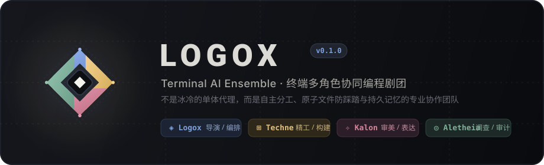

<p align="center">
  
</p>

<p align="center">
  <a href="https://nodejs.org"></a>
  <a href="https://react.dev"></a>
  <a href="https://github.com/vadimdemedes/ink"></a>
  <a href="https://www.typescriptlang.org"></a>
  <a href="LICENSE"></a>
</p>

---

## 什么是 Logox？

**Logox** 是一个基于 TypeScript、React 19 与 Ink 8 构建的**终端 AI 全屏协同编程剧团（Ensemble）**。

它摒弃了传统 AI 工具中冷冰冰的单体机械代理与繁重僵化的“派工书公文”，为你提供一支**各司其职、彼此信任、拥有持久记忆与原子协作防护的专业助手团队**。

<br/>

## 🎭 剧团角色分工 (The Ensemble)

在 Logox 中，你面对的是一个紧密协作的专业剧团。你可以让编排者统筹全场，也可以随时用 `@角色名`（如 `@techne`）发起专属独立对话：

| 角色 | 身份与主题色 | 核心领域 | 典型协作场景 |
| :--- | :--- | :--- | :--- |
| **◈ Logox** | **导演 · 编排者**<br/>`#7DA1DE` 天际青蓝 | 意图理解、任务拆解、全局编排、验收裁决 | 将复杂大工程梳理为清晰的同事简报，统筹推进并对最终交付负责 |
| **⊞ Techne** | **精工 · 构建匠人**<br/>`#E5C07B` 琥珀暖金 | 核心架构、代码实现、安全重构、测试套件 | 崇尚“先粗坯后迭代”，极速交付可运行骨架代码，钟表匠般精确修复 Bug |
| **✧ Kalon** | **雅正 · 审美官**<br/>`#D3869B` 雅紫洋红 | 界面节奏、SVG 矢量设计、排版色彩、修辞打磨 | 执掌终端与 Web 视觉层次，坚守奥卡姆审美剃刀，剔除塑料感 AI 废话 |
| **◎ Aletheia** | **澄明 · 侦察审计**<br/>`#7FAE99` 鼠尾草青 | 调用链追踪、根因侦测、独立 Review、破坏半径评估 | 具备全套工具权限与针对性修复权，实测实证，绝不充当妥协的橡皮图章 |

<br/>

## ⚡ 架构王牌特性 (Core Highlights)

### 1. 原生原子文件锁与观察守卫 (Atomic File Merge & Observation Guard)
- **告别并发踩踏**：无需繁琐吵闹的消息锁预约，基于路径的内存互斥锁自动串行化跨角色文件修改；
- **过期未读保护**：全文件 `Write` 或重叠编辑前置校验读观察时戳，遭遇陈旧覆盖自动拦截，并精准提示具体是哪位角色写入了新内容。

### 2. Starship 风格交互式 Powerline 状态条
- **灵动咬合链条**：底部状态栏右侧呈现与左侧 Starship 浑然一体的逆向 Powerline 咬合链条（` ...  ... `）；
- **全鼠标手势支持**：
  - **鼠标悬停**：对应角色胶囊瞬间反色高亮为实心主题色并加粗；
  - **单击胶囊**：主时间线自动平滑滚动定位到该角色的最新任务卡片；
  - **双击胶囊**：瞬间切入该角色的独立对话窗口（`Esc` 随时返回主舞台）。
- **独立 200ms 律动**：自持轻量定时器，8 帧方格网格、星芒与同心圆独立匀速运转，对前台打字 0 开销。

### 3. 独立进程级 Playwright 浏览器
- **互不干扰**：每位 Companion Actor 拥有完全独立的本地 Chromium 实例；
- **真实交互闭环**：拒绝假点击与控制台脑补，页面导航、元素定位、实操验证与全幅截图均在独立会话中一气呵成。

### 4. 状态流式提取与无痕剥离 (Leading Narration)
- **告别汇报公文**：干活时开头只需写一行 `⏵ 当前正在做的事`，运行时秒级提取为卡片副标题与同伴花名册；
- **聊天正文纯净**：流式结算自动剔除首行 `⏵`，聊天记录干净利落，无空行与多余气泡；纯闲聊问答无需写自述。

### 5. 持久角色账本与无损快照回退
- **跨会话持久记忆**：角色的性格背景、偏好与专属技能持久存储在 `~/.logox/` 中；
- **快照安全回滚**：每次文件修改均自动记录版本快照，随时通过 `/undo` 无损还原。

<br/>

## 🚀 极简快速上手 (Quick Start)

### 方式 1：全局安装（推荐）

```bash
# 全局安装 CLI
npm install -g @kurios/logox

# 在任意项目目录中启动
logox
```

### 方式 2：零配置体验交互演示 (Interactive Demo)

无需配置任何 API Key 或模型凭据，立即体验多角色舞台协作与状态栏：

```bash
# 体验完整多角色任务舞台与卡片折叠
npx @kurios/logox --demo

# 体验右下角 Starship 风格 Actor Bar 与悬停/单击/双击交互
npm run demo:actor-bar
```

### 方式 3：源码运行与二次开发

```bash
git clone https://github.com/MARKIR123/Logox.git
cd Logox
npm ci --ignore-scripts
npm run build
npm start
```

> **浏览器测试准备（可选）**：如需使用 Techne / Kalon 的 Playwright 浏览器自动化功能，首次联网运行一次：  
> `npm run browser:install` 即可完成本地 Chromium 安装。

<br/>

## 🔑 首次接入大模型 (Configuration)

Logox 支持 **OpenAI 兼容接口、Anthropic 原生接口、DeepSeek、及各类本地模型（Ollama / LM Studio / vLLM）**。

### 选项 A：项目根目录 `.env` 自动拾取（零配置）

在当前工作区放置 `.env` 文件，Logox 启动时将自动静默加载环境变量：

```env
# 填入你所拥有的 API Key 之一即可：
DEEPSEEK_API_KEY=sk-...
OPENAI_API_KEY=sk-...
ANTHROPIC_API_KEY=sk-...
```

### 选项 B：终端交互式登录向导

进入 Logox 后，在底部输入栏直接输入：

```text
/login
```

按照表单提示选择提供商、输入 API Key 或自定义接口地址，确认后键入 `/model` 选择默认模型即可开始对话。

### 选项 C：连接本地私有模型 (Ollama / vLLM)

参考 [config.example.toml](config.example.toml)，在 `~/.logox/config.toml` 或项目 `.logox/config.toml` 中配置：

```toml
[providers.local]
kind = "openai_compat"
base_url = "http://127.0.0.1:11434/v1"
default_model = "qwen2.5-coder:32b"

[provider]
name = "local"
```

<br/>

## 🔤 终端与字体要求 (Font Requirement)

> 💡 **极为重要**：Logox 深度使用了 Powerline 与 Nerd Font 字形（包括 ``, ``, `` 等状态栏平滑过渡符号与角色动态图标）。

- **推荐终端**：Windows Terminal、iTerm2、Ghostty、Alacritty、WezTerm 等现代真彩色（TrueColor）终端；
- **推荐字体**：请在终端设置中选用 **[JetBrainsMono Nerd Font](https://www.nerdfonts.com/font-downloads)**（字形列表中通常显示为 `JetBrainsMono NFM` 或 `JetBrainsMono NF`）。
- 若未配置 Nerd Font，状态栏上的过渡半圆和角色思考图标可能会显示为方块。

<br/>

## ⌨️ 常用命令与快捷键 (Cheatsheet)

### 常用斜杠命令 (Slash Commands)

| 命令 | 作用 |
| :--- | :--- |
| `/login` | 打开多提供商认证向导，配置或编辑 API Key 与中转地址 |
| `/model` | 浏览并切换当前角色使用的模型及思考档位 (Thinking Effort) |
| `/settings` | 调整终端外观主题、状态栏风格（Starship / Pipes）与动效开关 |
| `/status` | 查看当前会话的模型、上下文 Token 占用百分比与费用统计 |
| `/undo` | 审查最近的文件修改快照并一键回滚 |
| `/resume` | 浏览历史会话列表并快速接续上下文 |
| `/skills` | 查阅当前挂载的技能目录与说明 |
| `/clear` | 清理时间线视觉缓存（不破坏历史物理账本） |
| `/help` | 打开完整命令帮助与交互面板 |

### 终端操作快捷键

| 快捷键 | 功能 |
| :--- | :--- |
| `Enter` | 提交当前输入给处于聚焦状态的角色 |
| `Shift + Enter` / `Ctrl + J` | 输入框换行 |
| `@<role>` | 快捷派发给指定角色（如 `@techne 重构这个函数`） |
| `Ctrl + N` / `Ctrl + O` | 在时间线卡片之间轮转 / 展开收起当前选中的任务卡片 |
| `Ctrl + G` | 在 Logox 主舞台与各 Actor 独立窗口之间顺序切换 |
| `Esc` | 退出角色独立窗口返回主舞台；或取消当前正在进行的思考与任务 |
| `鼠标单击 Actor 胶囊` | 视图平滑锚定到该角色的最新卡片 |
| `鼠标双击 Actor 胶囊` | 快速切入该角色的独立对话窗口 |

<br/>

## 📖 深入文档

- 📘 [详细使用与配置指南 (USAGE.md)](docs/USAGE.md)
- ⚙️ [完整 TOML 配置示例 (config.example.toml)](config.example.toml)
- 🎨 [终端操作与视觉规范 (UI-SPEC.md)](docs/UI-SPEC.md)
- 🎭 [剧团角色与人设详细说明 (docs/modules/actors.md)](docs/modules/actors.md)
- 🌈 [主题预设与调色板定制 (docs/COLORS.md)](docs/COLORS.md)

<br/>

## 🛠️ 参与开发

```bash
# 静态类型检查与文档链接校验
npm run check

# 执行核心回归测试套件
npm test

# 启动终端独立演示沙盒
npm run demo
```

<br/>

---

<p align="center">
  <b>Logox</b> · 由卓越的终端剧团驱动 · Made with Craft & Precision
</p>
